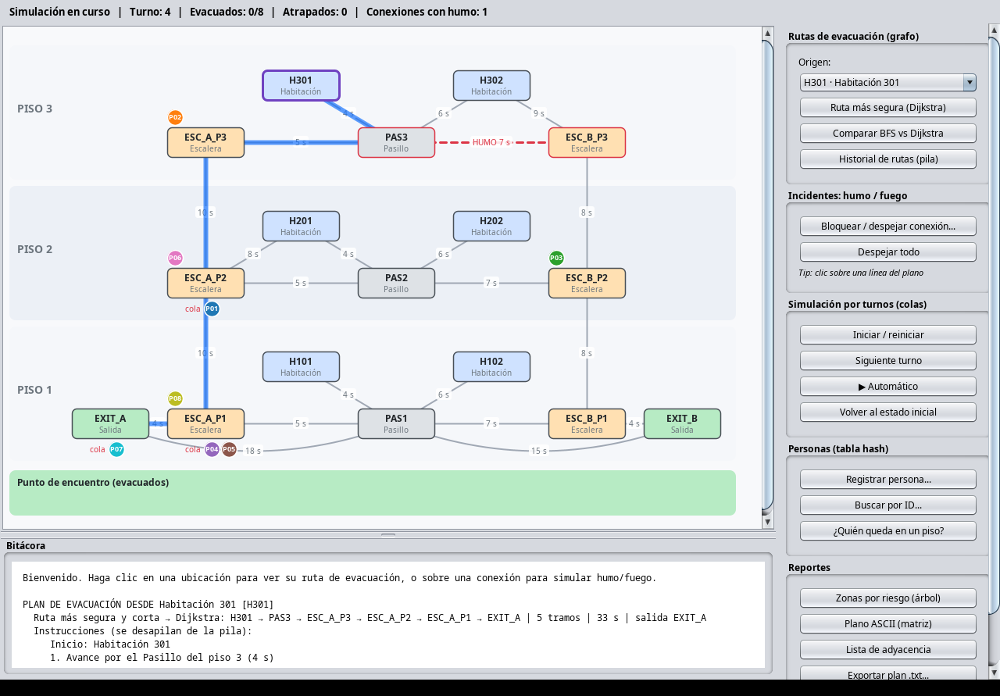
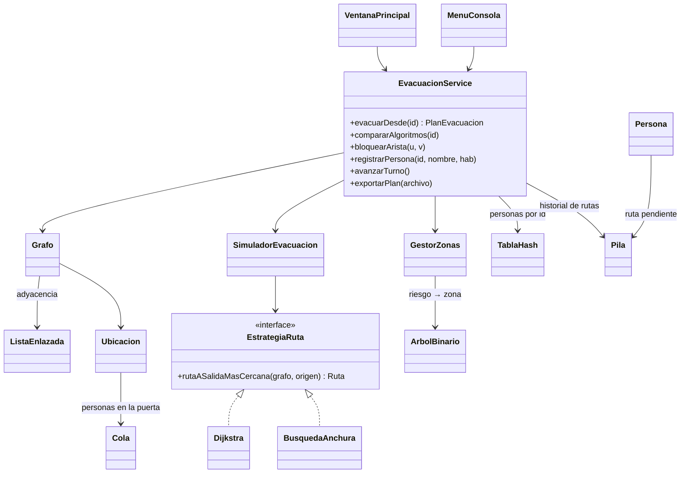

# 🏢 Simulador de rutas de evacuación en edificios — Proyecto 4

Simulador en **Java puro** de la evacuación de un edificio de varios pisos. El edificio se modela
como un **grafo ponderado** (habitaciones, pasillos, escaleras y salidas; pesos = tiempo en segundos)
cuyas conexiones pueden **bloquearse por humo o fuego**. El sistema calcula la **ruta más segura y
corta** desde cualquier ubicación hasta la salida de emergencia más cercana (Dijkstra a múltiples
salidas, comparado con BFS) y **simula el desalojo por turnos** con colas en escaleras y salidas.

> ✅ **Todas las estructuras de datos son implementaciones propias.** El proyecto no importa nada de
> `java.util` (ni `ArrayList`, `LinkedList`, `Stack`, `Queue`, `HashMap`, `TreeMap`, `PriorityQueue`,
> `Iterator`, `Scanner`...). Puede comprobarse con `grep -rn "import java.util" src` → sin resultados.



---

## 📋 Contenido

1. [Requisitos y ejecución](#-requisitos-y-ejecución)
2. [Estructuras de datos implementadas](#-estructuras-de-datos-implementadas)
3. [Algoritmos](#-algoritmos)
4. [El edificio de ejemplo](#-el-edificio-de-ejemplo)
5. [Simulación por turnos](#-simulación-por-turnos)
6. [Manual de uso](#-manual-de-uso)
7. [Arquitectura y POO](#-arquitectura-y-poo)
8. [Pruebas](#-pruebas)
9. [Cumplimiento del enunciado](#-cumplimiento-del-enunciado)
10. [Uso de IA (Claude)](#-uso-de-ia-claude)
11. [Equipo y video](#-equipo-y-video)

---

## 🚀 Requisitos y ejecución

- **JDK 17 o superior** (probado con OpenJDK 25). No se necesita Maven, Gradle ni librerías externas.

| Acción | Linux / macOS | Windows |
|---|---|---|
| Compilar y generar `evacuacion.jar` | `./compilar.sh` | `compilar.bat` |
| Interfaz gráfica (Swing) | `./ejecutar.sh` | `ejecutar.bat` |
| Menú de consola | `./ejecutar.sh --consola` | `ejecutar.bat --consola` |
| Pruebas automáticas | `./probar.sh` | — |

También se puede abrir la carpeta en **IntelliJ IDEA / NetBeans / VS Code**: marcar `src` como carpeta
de fuentes (y `test` como carpeta de pruebas) y ejecutar `evacuacion.App`.

---

## 🧱 Estructuras de datos implementadas

Todas están en el paquete [`evacuacion.estructuras`](src/evacuacion/estructuras) y son genéricas.

| Estructura | Clase | Elemento / clave | Problema que resuelve en el proyecto | Complejidad |
|---|---|---|---|---|
| **Lista enlazada** | `ListaEnlazada<T>` | `Persona`, `Ubicacion`, `Arista` | “¿Quién queda en el piso 3?”, listas de adyacencia del grafo, ubicaciones de cada zona, bitácora de eventos. Se recorre nodo a nodo sin arreglos. | agregar O(1) · buscar O(n) |
| **Cola (FIFO)** | `Cola<T>` | `Persona` en puerta/escalera | Cuello de botella: cada escalera/salida deja pasar *k* personas por turno en orden de llegada. También la usa BFS. | O(1) |
| **Pila (LIFO)** | `Pila<T>` | `Ubicacion`, `String`, `Ruta` | Reconstruir la ruta caminando **hacia atrás** desde la salida; instrucciones “Baje escalera B → Pasillo → Salida”; historial de rutas calculadas; ruta pendiente de cada persona. | O(1) |
| **Tabla hash** | `TablaHash<K,V>` | `idPersona → Persona` | Localizar a una persona en O(1) promedio y saber su piso, habitación y si fue evacuada. También `id → Ubicacion` en el grafo e `id → Zona`. Encadenamiento separado + rehash al superar factor de carga 0.75. | O(1) promedio |
| **Árbol binario de búsqueda** | `ArbolBinario<K,V>` | `nivelRiesgo → Zona` | Priorizar las zonas más peligrosas para enviar la brigada (inOrden inverso). Soporta claves repetidas, preorden, postorden, eliminación y **rebalanceo O(n)** por medianas. | O(h) |
| **Grafo** | `Grafo` (paquete `modelo`) | Nodos = ubicaciones; peso = tiempo; bloqueo | Todas las rutas de evacuación y el camino mínimo a la salida. Listas de adyacencia, O(V+E) en memoria. | — |
| **Montículo mínimo** | `MonticuloMinimo<T>` | `Ubicacion` con prioridad = tiempo | Cola de prioridad de Dijkstra (reemplaza a `PriorityQueue`). | O(log n) |
| **Matriz 2D** | `PlanoEdificio` | `Ubicacion[pisos][columnas]` | Visualización ASCII piso por piso (Fase 3). | O(1) por celda |

Interfaces de apoyo propias: `Iterador<T>` (en lugar de `java.util.Iterator`), `Accion<T>` y
`Condicion<T>` (en lugar de `java.util.function`), y `EstructuraVaciaException`.

---

## 🧠 Algoritmos

### Dijkstra a múltiples salidas — `algoritmos/Dijkstra.java`
- Calcula el **menor tiempo** desde el origen a todos los nodos usando el montículo propio y
  *eliminación perezosa* (las entradas obsoletas se descartan al extraerlas).
- Con una sola ejecución obtiene la distancia a **todas** las salidas y elige la mínima.
- Ignora las conexiones bloqueadas ⇒ la ruta devuelta es la **más segura y corta**.
- **Complejidad:** O((V + E) log V).

### BFS — `algoritmos/BusquedaAnchura.java`
- Recorre por niveles con la `Cola` propia; la primera salida que se desencola es la de **menos pasos**.
- No considera tiempos. **Complejidad:** O(V + E).

### Comparación BFS vs Dijkstra — `algoritmos/ComparacionRutas.java`
Ejemplo real del edificio, desde **H101**:

| Algoritmo | Ruta | Tramos | Tiempo |
|---|---|---|---|
| BFS | H101 → PAS1 → EXIT_A | **2** | 22 s |
| Dijkstra | H101 → PAS1 → ESC_A_P1 → EXIT_A | 3 | **13 s** |

BFS minimiza pasos, pero en una evacuación importa el **tiempo**: Dijkstra ahorra 9 s.

### Reconstrucción de la ruta con pila — `algoritmos/ConstructorRuta.java`
Ambos algoritmos guardan el predecesor de cada nodo. Para obtener el camino se parte de la salida y se
**camina hacia atrás** apilando cada nodo; al final el tope de la pila es el origen, así que desapilar
entrega los pasos en el orden correcto.

### Caso borde: habitación sin ruta
Si no existe ruta libre (por ejemplo, se bloquea `H301 ↔ PAS3`), el sistema:
1. Muestra el mensaje “⚠ No existe ruta libre de humo/fuego”.
2. **Sugiere una ruta alternativa de emergencia**: Dijkstra permitiendo cruzar conexiones bloqueadas con
   su tiempo multiplicado ×10, es decir, la que atraviesa la menor cantidad de humo (solo con brigada).
3. Si la ubicación está totalmente aislada, recomienda refugiarse en el lugar y esperar a la brigada.
4. En la simulación, la persona pasa a estado **ATRAPADO** y su zona sube de prioridad en el árbol.

### Zonas por nivel de riesgo — `servicio/GestorZonas.java`
```
riesgo = riesgoBase + 25 × conexiones con humo en la zona + 5 × personas que siguen dentro
```
Se recalcula al bloquear/desbloquear y en cada turno; el árbol se reconstruye y se **rebalancea**.
El recorrido **inOrden** produce el reporte (menor → mayor) y el **inOrden inverso** el orden de la brigada.

---

## 🏗️ El edificio de ejemplo

`datos/EdificioDemo.java` — 3 pisos, **17 ubicaciones** (≥ 12 pedidas), **22 conexiones**,
2 escaleras (A y B, con un descanso por piso), 2 salidas (`EXIT_A`, `EXIT_B`), 8 personas y 5 zonas.

```
Columna:   0        1          2        3        4        5          6
PISO 3            ESC_A_P3    H301     PAS3     H302    ESC_B_P3
PISO 2            ESC_A_P2    H201     PAS2     H202    ESC_B_P2
PISO 1   EXIT_A   ESC_A_P1    H101     PAS1     H102    ESC_B_P1   EXIT_B
```

- Cada habitación conecta con el pasillo de su piso; cada pasillo con ambas escaleras.
- Puertas de servicio: `H302 ↔ ESC_B_P3` (9 s) y `H201 ↔ ESC_A_P2` (8 s).
- En planta baja el lobby (`PAS1`) llega directo a las salidas, pero es lento (18 s / 15 s).

| Persona | ID | Habitación | | Persona | ID | Habitación |
|---|---|---|---|---|---|---|
| Ana Torres | P01 | H301 | | Sofía Peña | P05 | H202 |
| Luis Gómez | P02 | H301 | | Jorge Ríos | P06 | H202 |
| Marta Ruiz | P03 | H302 | | Elena Vargas | P07 | H101 |
| Carlos Díaz | P04 | H201 | | Pedro Castro | P08 | H102 |

---

## ⏱️ Simulación por turnos

`servicio/SimuladorEvacuacion.java`. En cada turno:

1. **Cuellos de botella:** cada escalera (capacidad 1/turno) y salida (2/turno) desencola, en orden
   FIFO, a las personas que pueden cruzar. Quien cruza una salida queda con `evacuado = sí` en la tabla hash.
2. **Movimiento libre:** el resto avanza un nodo por su ruta (desapilando de su `Pila`). Si el siguiente
   nodo es una escalera o salida, la persona se **forma en la cola** de esa puerta.
3. Cada persona actúa como máximo una vez por turno.
4. Si se bloquea o despeja una conexión **durante** la simulación, se recalcula la ruta de cada persona
   desde su posición actual y se reorganizan las colas conservando el orden de llegada.

La simulación termina cuando todos están evacuados o atrapados. Con el escenario de ejemplo sin humo,
las 8 personas salen en **10 turnos**.

---

## 📖 Manual de uso

### Interfaz gráfica (`./ejecutar.sh`)

| Zona | Qué hace |
|---|---|
| **Plano** | Pisos, ubicaciones (azul = habitación, gris = pasillo, naranja = escalera, verde = salida), conexiones con su tiempo, personas (círculos con su ID), colas (“cola” bajo escaleras/salidas) y punto de encuentro. |
| **Clic en una ubicación** | Calcula su ruta de evacuación: se resalta en **azul** (o en **naranja** si es ruta de emergencia por humo) y las instrucciones aparecen en la bitácora. |
| **Clic en una conexión** | Bloquea (línea roja punteada “HUMO”) o despeja la conexión. Las rutas y riesgos se recalculan al instante. |
| Rutas de evacuación | Ruta más segura (Dijkstra) · Comparar BFS vs Dijkstra · Historial de rutas (pila). |
| Incidentes | Elegir una conexión de una lista para bloquear/despejar · Despejar todo. |
| Simulación | Iniciar/reiniciar · Siguiente turno · ▶ Automático (un turno cada 0,7 s) · Volver al estado inicial. |
| Personas | Registrar persona · Buscar por ID (tabla hash) · ¿Quién queda en un piso? (lista enlazada). |
| Reportes | Zonas por riesgo (árbol) · Plano ASCII (matriz) · Lista de adyacencia · Exportar plan .txt. |
| Barra superior | Estado de la simulación, turno, evacuados, atrapados y conexiones con humo. |

### Consola (`./ejecutar.sh --consola`)

```
 1. Ver plano ASCII del edificio          9. Reporte de zonas por riesgo (árbol)
 2. Ruta más segura (Dijkstra)           10. Iniciar / reiniciar simulación
 3. Comparar BFS vs Dijkstra             11. Avanzar un turno
 4. Bloquear conexión (humo / fuego)     12. Simular hasta el final
 5. Desbloquear conexión                 13. Historial de rutas (pila)
 6. Registrar persona                    14. Lista de adyacencia del grafo
 7. Buscar persona por ID (hash)         15. Exportar plan a plan_evacuacion.txt
 8. ¿Quién queda en un piso?              0. Salir
```

Ejemplo de salida (opción 2, origen `H301`):
```
PLAN DE EVACUACIÓN DESDE Habitación 301 [H301]
  Ruta más segura y corta → Dijkstra: H301 → PAS3 → ESC_B_P3 → ESC_B_P2 → ESC_B_P1 → EXIT_B | 5 tramos | 31 s | salida EXIT_B
  Instrucciones (se desapilan de la pila):
     Inicio: Habitación 301
     1. Avance por el Pasillo del piso 3 (4 s)
     2. Entre a la Escalera B en el piso 3 (7 s)
     3. Baje por la Escalera B hasta el piso 2 (8 s)
     4. Baje por la Escalera B hasta el piso 1 (8 s)
     5. Salga del edificio por la Salida de emergencia B (4 s)
```

### Plan exportado (.txt)
Contiene: plano ASCII, lista de adyacencia, plan e instrucciones de **cada habitación** con la
comparación BFS, ficha de cada persona, reporte de zonas con el árbol y el estado de la simulación.

---

## 🧩 Arquitectura y POO

```
src/evacuacion/
├── App.java                  Punto de entrada (GUI o --consola)
├── estructuras/              Lista, Cola, Pila, TablaHash, ArbolBinario, MonticuloMinimo, Iterador...
├── modelo/                   Grafo, Ubicacion, Arista, Persona, Zona, Ruta, PlanoEdificio (matriz 2D)
├── algoritmos/               EstrategiaRuta ← Dijkstra, BusquedaAnchura; ComparacionRutas
├── servicio/                 EvacuacionService (fachada), SimuladorEvacuacion, GestorZonas,
│                             GeneradorInstrucciones, PlanEvacuacion, MapaAscii, ExportadorPlan
├── datos/                    EdificioDemo (escenario de ejemplo)
└── vista/
    ├── consola/MenuConsola
    └── gui/                  VentanaPrincipal, PanelEdificio, Paleta
test/evacuacion/pruebas/      PruebasProyecto (49 pruebas)
```



Principios aplicados:
- **Encapsulamiento:** atributos privados; los nodos internos de las estructuras no se exponen.
- **Abstracción y polimorfismo:** `EstrategiaRuta` permite intercambiar Dijkstra/BFS (patrón Estrategia).
- **Fachada:** `EvacuacionService` es el único punto de entrada para la consola y la GUI, por lo que la
  lógica no depende de la interfaz.
- **Responsabilidad única:** cada clase hace una cosa (calcular rutas, generar instrucciones, simular, exportar...).
- **Clean Code:** nombres descriptivos en español, métodos cortos, constantes con nombre en lugar de
  números mágicos, validación con excepciones claras y Javadoc en todas las clases públicas.

---

## 🧪 Pruebas

`./probar.sh` ejecuta **49 pruebas** sin dependencias externas (`test/evacuacion/pruebas/PruebasProyecto.java`):
estructuras (FIFO, LIFO, rehash con 1000 claves, árbol con duplicados/eliminación/rebalanceo, montículo),
algoritmos (tiempos y tramos esperados de Dijkstra y BFS), bloqueos, caso borde sin ruta, instrucciones,
simulación completa, bloqueo a mitad de la simulación, riesgo de zonas y consultas de personas.

```
Resultado: 49 aprobadas, 0 fallidas
```

---

## ✅ Cumplimiento del enunciado

| Requisito | Dónde |
|---|---|
| **Fase 1** — 12+ nodos con 2 escaleras y 2 salidas | `EdificioDemo` (17 nodos) |
| Grafo con pesos y `bloquearArista(u, v)` | `Grafo.bloquearArista` / `EvacuacionService.bloquearArista` |
| `TablaHash<String, Persona>` con 8 personas | `EvacuacionService.personasPorId`, `EdificioDemo.registrarPersonas` |
| `Cola<Persona>` en una puerta, paso por tick | `Ubicacion.colaEspera`, `SimuladorEvacuacion.dejarPasar` |
| `Pila<String>` de instrucciones | `GeneradorInstrucciones.generar` |
| **Fase 2** — `EvacuacionService.evacuarDesde(habitacionId)` con Dijkstra a múltiples salidas | `EvacuacionService.evacuarDesde`, `Dijkstra.mejorRutaASalida` |
| Comparar BFS vs Dijkstra | `ComparacionRutas` |
| `ArbolBinario<Integer, Zona>` + inOrden para reporte | `GestorZonas.informe` |
| Simulación: cola en escaleras avanza, hash marca `evacuado = true` | `SimuladorEvacuacion.avanzarTurno` |
| Caso borde: habitación sin ruta → mensaje + ruta alternativa | `PlanEvacuacion`, `Dijkstra.rutaDeEmergencia` |
| **Fase 3** — Matriz 2D (pisos × pasillos) y visual ASCII | `PlanoEdificio`, `MapaAscii` |
| Exportar plan a .txt | `ExportadorPlan` |
| Interfaz gráfica interactiva (punto extra) | `vista/gui` |
| Sin clases de colecciones de Java | ningún `import java.util` |

---

## 🤖 Uso de IA (Claude)

Siguiendo la recomendación del enunciado, se usó **Claude** (Anthropic) como asistente después de la Fase 1:

- **Diseño:** discutir el modelado del edificio como grafo (escaleras con un descanso por piso para
  que el costo dependa de cuántos pisos se bajan) y elegir pesos que hicieran visible la diferencia BFS vs Dijkstra.
- **Revisión de algoritmos:** Dijkstra con eliminación perezosa sobre un montículo propio y la
  reconstrucción de rutas con pila.
- **Interfaz gráfica:** generación del panel Swing interactivo (dibujo del grafo, clics sobre nodos y conexiones).
- **Calidad:** revisión de Clean Code, Javadoc y redacción de las 49 pruebas automáticas.

Todo el código generado fue revisado, ejecutado y probado por el equipo; las decisiones de diseño se
documentan en los comentarios de cada clase.

---

## 👥 Equipo y video

El proyecto se dividió en 4 partes; cada integrante subió la suya al repositorio:

| Parte | Integrante | Paquetes / archivos | Contenido |
|---|---|---|---|
| 1 | **Sebastián** | `estructuras/`, documentación y scripts | Lista enlazada, cola, pila, tabla hash, árbol binario, montículo, iterador |
| 2 | **Oscar** | `modelo/`, `algoritmos/` | Grafo, ubicaciones, personas, zonas, rutas, matriz 2D, Dijkstra, BFS |
| 3 | **Juan** | `servicio/`, `datos/` | `EvacuacionService`, simulación por turnos, zonas, instrucciones, ASCII, exportar .txt, edificio de ejemplo |
| 4 | **Jhoan** | `vista/`, `App.java`, `test/` | Interfaz gráfica Swing, menú de consola, punto de entrada y pruebas |

La forma de trabajar con el repositorio está en [`GUIA_COLABORACION.md`](GUIA_COLABORACION.md).

🎥 **Video (manual de uso, ≥ 7 min):** _pegar aquí el enlace de YouTube_

El guion sugerido para el video está en [`docs/GUION_VIDEO.md`](docs/GUION_VIDEO.md).
